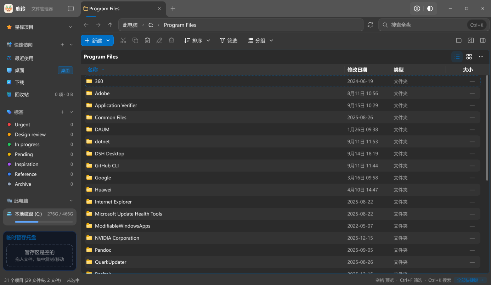
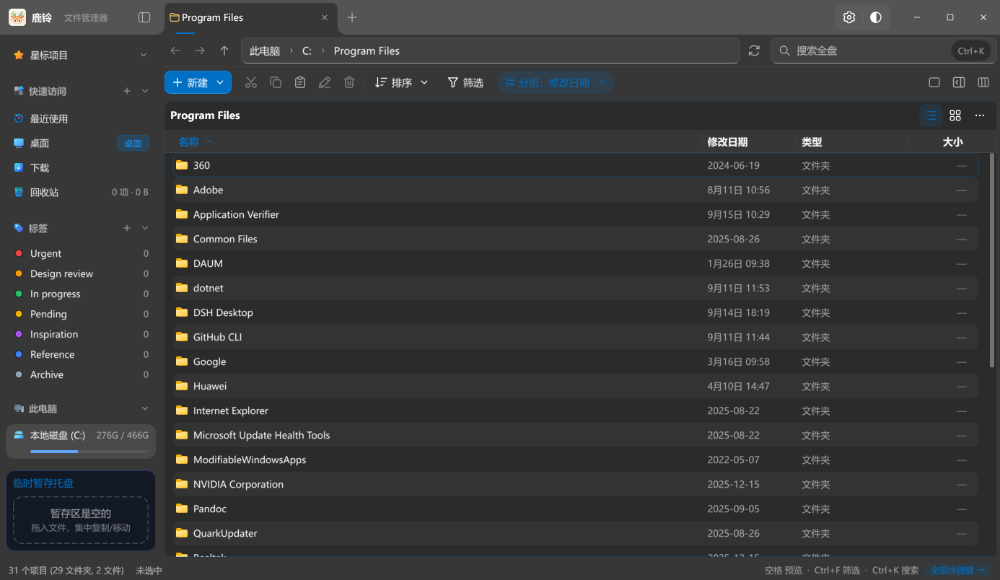
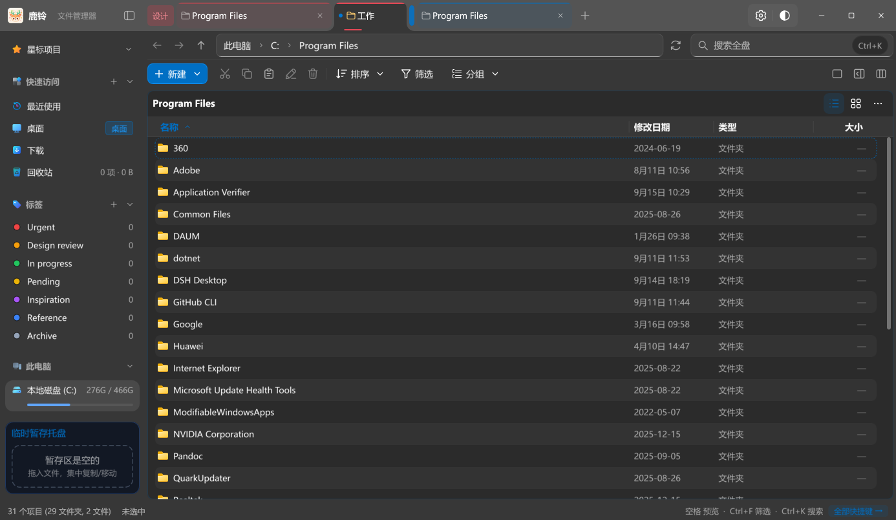
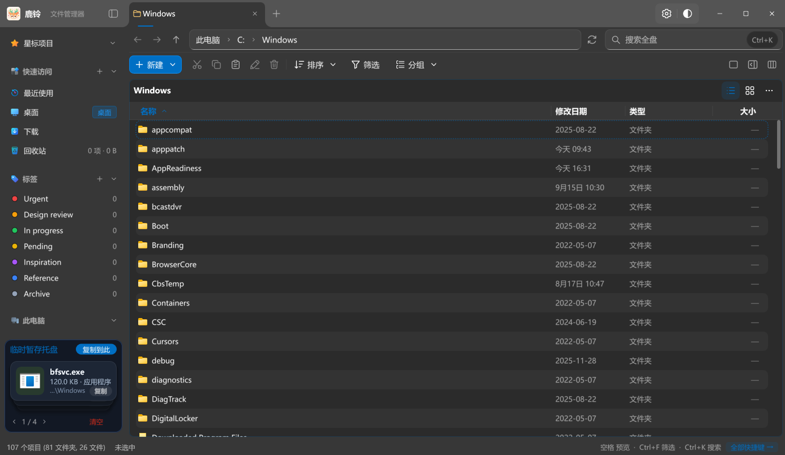
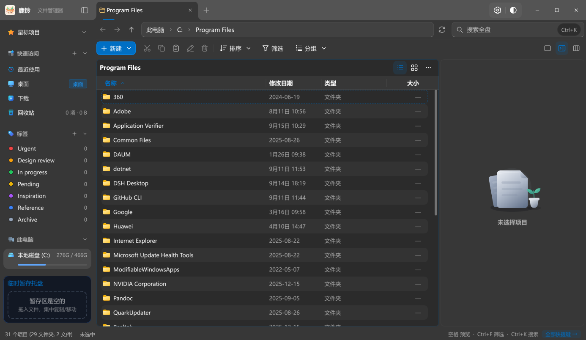

# 鹿铃（luling）

**Windows 上的文件管理器：浏览、搜索、整理，都在一个工作空间里完成。**

多标签与多窗格、全盘索引与拼音搜索、空格快速预览、暂存盘与文本对比，再加上可自定义的外观和贴近系统的集成。

[下载最新版](https://github.com/susu147226/fawn-bell/releases/latest) · [更新记录](https://github.com/susu147226/fawn-bell/releases) · [问题反馈](https://github.com/susu147226/fawn-bell/issues) · [English](README.en.md)



## 下载与安装

| 版本 | 适用系统 | 文件 |
| --- | --- | --- |
| 安装版（64 位） | Windows 10 / Windows 11 | `LulingSetup-版本.exe` |
| 免安装版（64 位） | Windows 10 / Windows 11 | `Luling-版本-portable-win-x64.zip` |

安装版可选注册 **LulingIndex** 服务，用全盘索引做到即时搜索；免安装版解压即用，配置与缓存保存在用户应用数据目录，索引服务需要通过安装版部署。

界面提供简体中文、繁體中文与 English，默认跟随 Windows，可在「设置 → 显示语言」中切换。

## 浏览与视图

- 单栏、左右分屏、上下分屏、三栏、四宫格五种布局（Ctrl+1 / 2 / 3 / 4），每个标签页各自记住布局与位置。
- 图标（四档）、列表、详细信息、平铺、内容、列、文件夹八种视图；列视图逐级展开子目录。
- 排序七种键、升序降序、文件夹优先三档；按名称、日期、类型、大小分组并吸顶；每个文件夹分别记住视图、排序与分组，可一键应用到所有文件夹。
- 详细信息视图提供智能日期（「今天 14:32」）、斑马纹、彩色扩展名标签、大小比例条，列宽按内容自适应，右键列标题可勾选显示哪些列。
- 双栏文件夹对比标出两侧不同、缺失与较新的项目；文件夹大小在后台统计，不阻塞浏览。



## 标签页与窗口

- 标签页可分组、可拖出成为新窗口，数量上限可设；标签可固定、可着色。
- 标签栏可以放到侧栏纵向排列（Ctrl+B 收起 / 展开）。
- 重启后恢复上次的标签页、布局与位置。



## 搜索

- **文件名搜索**由 LulingIndex 驱动，结果实时更新；可限定在当前文件夹或指定文件夹。
- 支持全拼、首字母与多音字，例如输入 `sh` 能找到「品牌设计」「城市夜景」「山湖晨雾」，命中文字高亮。
- **内容搜索**覆盖文本与代码、PDF、Word、Excel、PowerPoint 等，结果流式加载；打开所在位置后可以后退回原结果。
- 高级搜索（Ctrl+Shift+F）按类型、日期、大小等条件筛选；全局快速搜索（Alt+Space）随时呼出，也可「在主界面搜索」查看全部结果。
- 地址栏直接输入 `cmd`、`powershell`、`pwsh` 或 `wt`，在当前文件夹打开终端。

## 空格快速预览

选中文件按空格即可预览，不必打开对应程序：

- Markdown 按排版显示，代码语法高亮，PDF 逐页翻看，文件夹列出内容。
- CSV / TSV / XLSX 以表格呈现；JSON / XML 显示为可折叠的树；Jupyter Notebook 按单元格显示。
- DOCX、EPUB 与 Office 文档无需安装对应软件即可阅读；压缩包显示目录树并支持包内搜索。
- 视频可播放、拖动与逐帧，动态 WebP / APNG 可播放；另支持 SVG、PSD、AI、DWG 缩略图与字体等格式。

「设置 → 快速预览 · 支持的格式」列出全部可预览格式，并检测 HEIF / HEVC / AV1 / WebP 系统扩展是否已安装。

## 暂存盘与对比

复制或剪切（Ctrl+C / Ctrl+X）的文件会先收进左下角的暂存盘，可以跨文件夹、跨标签页收集，再一次性拖到目标位置；拖放默认复制，按住 Shift 为移动。

暂存两个文件时可以对照位置、修改时间、大小与内容；文本文件点击「查看差异」打开对比窗口，支持并排 / 统一视图、行内高亮、仅看差异、忽略空白与大小写，以及 F7 / Shift+F7 跳转。



## 详细信息与详情面板

选中文件后，右侧详情面板显示预览、基本属性与标签；多选时可以打开合并属性窗口，或批量打标签、批量重命名。



## 外观

- 浅色、深色或跟随系统，标题栏一键切换；可选主题色、窗口效果（Mica、亚克力）、壁纸背景、界面透明度与背景模糊。
- 文字渲染提供「自动 / 清晰 / 平滑」三档，列表行高可选紧凑、标准、宽松。
- 七种颜色标签可给文件与文件夹做标记，侧栏按标签汇总，也能直接在资源管理器右键菜单里打标签。
- 侧栏分区可拖动排序、折叠、隐藏。

## 融入 Windows

- 可在设置中把鹿铃设为默认文件管理器，接管文件夹打开、`Win+E` 与桌面「此电脑」；「打开文件所在位置」会在鹿铃中选中该文件。随时可关闭并恢复原样。
- 右键菜单合并资源管理器与 Windows 11 新式菜单项（VS Code、Windows Terminal、NanaZip 等），自带项可以隐藏。
- 支持开机启动到托盘、指定默认位置、文件被占用时列出占用进程并可结束进程后重试。
- 「此电脑」显示磁盘类型与容量条。

## 自动更新

鹿铃启动后会自动检查新版；有更新时窗口内出现提示，点击即可下载安装包，校验通过后打开安装向导。也可以在「设置 → 关于与诊断」中手动检查，或关闭「自动检查更新」。下载可取消，安装时按 Windows 提示确认管理员权限。

更新清单与安装包默认依次尝试 ghproxy.net、gh-proxy.com 加速源，失败后自动切换，最后回退到 GitHub，无需设置；所有来源都必须通过签名与安装包校验。

## 从源码构建

需要 Windows x64、Visual Studio 2022 C++ 工具（v143）、CMake 3.25+ 与 Ninja；发布构建另需 PowerShell 7.2+ 与 Python 3（打包安装程序与签名更新清单）。

```powershell
# 配置与构建（也可用 CMakePresets.json 的 x64-debug / x64-release）
.\build_release.bat

# 运行产物
.\build\luling.exe

# 回归测试（cmake/tests.cmake 注册，等价的发布门禁在 scripts/build_release_ci.ps1）
pwsh ./scripts/run_tests.ps1
```

技术栈为 C++20、Win32、Direct2D 与 DirectComposition；文件系统、索引、预览与 Shell 任务分属各自模块，不阻塞界面。发布脚本会校验仓库内固定版本的 LumaText SDK（`cmake/lumatext-sdk.json` 固定清单 SHA-256）；未找到 LumaText 时回退 DirectWrite。

更多说明：[自动更新与发布](docs/automatic-updates.md) · [Windows 兼容性](docs/windows-compatibility.md) · [索引存储与迁移](docs/index-migration.md)

## 许可证与致谢

本仓库是**源码可见的专有软件**，不是开源项目。

- 本项目作者原创的代码、资源与文档：版权归 云舒眠眠，条款见 [LICENSE-luling.md](LICENSE-luling.md)（允许个人非商业获取、编译、运行与本地修改；禁止商业使用、再分发、更换许可证或移除署名）。
- 本仓库包含基于 [Pulse](https://github.com/jimmgreen/pulse) v1.0.53 的代码，该部分依 [Apache License 2.0](LICENSE) 授权。来源、修改声明与第三方组件清单见 [NOTICE](NOTICE)。
- `third_party/` 下的组件（SQLite、md4c、ib-pinyin-cpp、LZMA SDK、PDFium、LumaText SDK）各自遵循随附的许可证原文，逐项列于 NOTICE。
- 预览增强包不随仓库分发，由应用运行时按需下载；其名称与许可证文本在「设置 › 快速预览 › 支持的格式」中可见。
